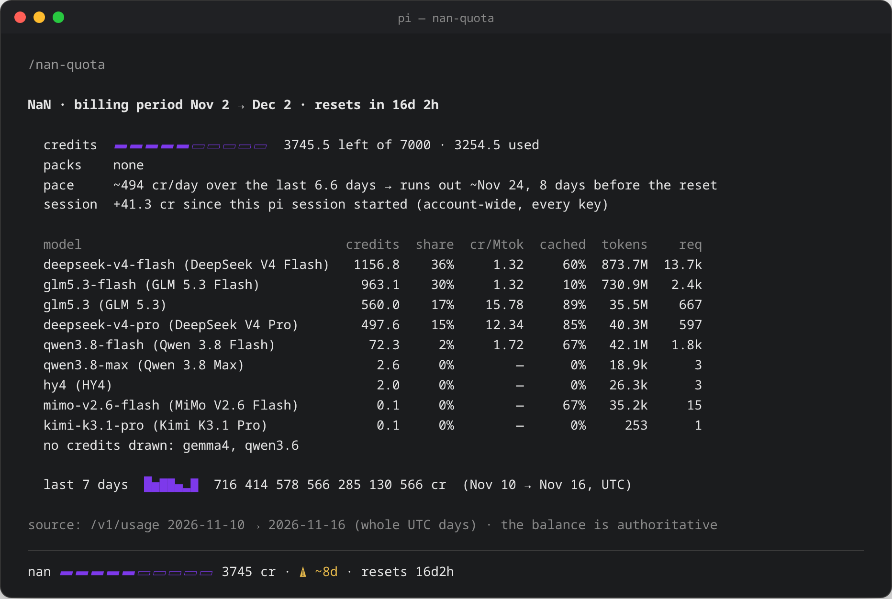

# pi-nan-quota

Your [NaN Builders](https://nan.builders) credits in the [pi](https://pi.dev)
footer: how much of the shared pool is left, when it resets, and a warning when
your recent pace will drain it before the reset. `/nan-quota` adds the
per-model breakdown: credits, share, effective price and cache hits.

<p align="center">
  
</p>

Read-only. It does not register a provider, does not write any configuration,
does not touch `auth.json`, and sends nothing anywhere while you are using a
model from another provider (unless you ask for that with `alwaysShow`).

> Unofficial. Not affiliated with NaN Builders or Helmcode.

## Install

```bash
pi install npm:pi-nan-quota
```

Then pick a NaN model (`/model`). The segment appears in the footer within a
second or two.

### Requirements

- **pi ≥ 1.3.0** and **Node.js ≥ 22**.
- **A NaN API key** from a plan with credits (*nan_member*, 7,000 credits per
  billing period, or *Premium*, 20,000) or from a credit pack. The *Community*
  plan includes no credits. Create the key at
  [cloud.nan.builders](https://cloud.nan.builders/) → Settings → API Keys.
- **The NaN provider configured in pi**, any of:
  - the `nan` block in `~/.pi/agent/models.json` from
    [NaN's pi guide](https://nan.builders/docs/pi) (or written by the NaN CLI);
  - [`@gtrabanco/pi-nan-provider`](https://www.npmjs.com/package/@gtrabanco/pi-nan-provider);
  - any provider whose `baseUrl` is on `nan.builders`, whatever its id.

The key is read from that provider's stored credential (`/login <provider>`),
falling back to `NAN_API_KEY`.

## What you see

Since 2026-11-09 NaN bills **one pool of credits per billing period** for every
model, drawn at each model's price per token (input, cached input and output).
There is no allowance per model, so the extension tracks the pool.

### Footer

Drawn only while the active model talks to NaN (or always, with `alwaysShow`):

| Situation | Segment |
|---|---|
| On pace to last until the reset | `nan ▰▰▰▰▰▰▰▱▱▱ 4980 cr · resets 15d18h` |
| Your recent pace drains the pool before the reset | `nan ▰▰▰▰▰▱▱▱▱▱ 3745 cr · ⚠ empty in ~8d · resets 16d2h` |
| Credit packs on top of the plan's allowance | `nan ▰▰▰▱▱▱▱▱▱▱ 2100+1000 cr · resets 9d2h` |
| Last refresh failed; the data is 40 minutes old | `nan ▰▰▰▰▰▰▰▱▱▱ 4980 cr · resets 15d18h ·40m` |
| The pool is spent (or a run ended on `402`) | `nan ⛔ credits spent — resets 15d18h` |
| The subscription is inactive (e.g. failed payment) | `nan ⏸ subscription inactive — cloud.nan.builders` |
| The account is not billed in credits | `nan 1.2B tokens (30d)` |
| The active model is not served to this key | `nan glm5.3 not available on this key` |
| First read still in flight, or no key | `nan ···` |
| The active model is not a NaN one | *(nothing)* |

- **The gauge** is ten pills for what is left of the plan's allowance this
  period: full at the start of the period, empty when it is spent. The scale is
  uniform: empty only at 0 %, full only at 100 %, nine steps of eleven points
  in between. Credit packs are not part of the gauge. They are shown as
  `+1000` after the number.
- **The number** is whole credits left, rounded down.
- **`⚠ empty in ~7d`** appears only when your recent pace runs the pool (packs
  included) dry before the reset. It is the time left at that pace. The pace
  is your spend over the last seven UTC days, not the average of the whole
  period, so it follows changes in how you work. It needs twelve hours of data
  before it projects anything.
- **`resets 15d18h`** counts down to the end of your billing period, which
  starts on your Stripe anchor, not on the 1st.
- The credit number turns to the warning colour when under 10 % of the
  allowance is left and there are no packs.

The pool is shared by every model, so the segment is the same whichever NaN
model is active.

### `/nan-quota`

```
NaN · billing period Nov 2 → Dec 2 · resets in 16d 2h

  credits  ▰▰▰▰▰▱▱▱▱▱  3745.5 left of 7000 · 3254.5 used
  packs    none
  pace     ~494 cr/day over the last 6.6 days → runs out ~Nov 24, 8 days before the reset
  session  +41.3 cr since this pi session started (account-wide, every key)

  model                                  credits  share  cr/Mtok  cached  tokens    req
  deepseek-v4-flash (DeepSeek V4 Flash)   1156.8    36%     1.32     60%  873.7M  13.7k
  glm5.3-flash (GLM 5.3 Flash)             963.1    30%     1.32     10%  730.9M   2.4k
  glm5.3 (GLM 5.3)                         560.0    17%    15.78     89%   35.5M    667
  deepseek-v4-pro (DeepSeek V4 Pro)        497.6    15%    12.34     85%   40.3M    597
  qwen3.8-flash (Qwen 3.8 Flash)            72.3     2%     1.72     67%   42.1M   1.8k
  qwen3.8-max (Qwen 3.8 Max)                 2.6     0%        —      0%   18.9k      3
  hy4 (HY4)                                  2.0     0%        —      0%   26.3k      3
  mimo-v2.6-flash (MiMo V2.6 Flash)          0.1     0%        —     67%   35.2k     15
  kimi-k3.1-pro (Kimi K3.1 Pro)              0.1     0%        —      0%     253      1
  no credits drawn: gemma4, qwen3.6

  last 7 days  █▅▇▇▄▂▇  716 414 578 566 285 130 566 cr  (Nov 10 → Nov 16, UTC)

source: /v1/usage 2026-11-10 → 2026-11-16 (whole UTC days) · the balance is authoritative
```

- **cr/Mtok** is what a million tokens actually cost you on that model, with
  your cache hits included. It is the number to look at when choosing between
  models: here the larger models cost about ten times as much per token as the
  flash ones.
- **cached** is the share of input tokens served from the prompt cache, which
  NaN bills cheaper.
- **session** is the change in the balance since this pi session started. The
  balance belongs to the account, so it also counts other sessions, subagents
  and keys running at the same time.
- Per-model rows are counted by whole UTC days, while the billing period starts
  mid-day, so the period's first day can include the tail of the previous one.
  The balance at the top is the authoritative number.

The table is a custom entry, which pi keeps out of the model's context: asking
for it costs no tokens.

- `/nan-quota refresh` reads the API now, ignoring the cache.
- `/nan-quota help` lists the subcommands and settings.

## Where the numbers come from

The extension carries no plan list, no model list and no prices. It asks NaN's
documented API:

- **The balance, the billing period and the per-model credits** come from
  [`GET /v1/usage`](https://nan.builders/docs/api). It reports the current
  billing period's allowance, the credits used and remaining, the pack credits
  and their expiry, whatever window is asked for, and per day and per model it
  reports the credits billed. NaN says the balance can lag the live one by up
  to a minute.
- **Which models your key can call** comes from
  [`GET /v1/models`](https://nan.builders/docs/api), which NaN filters by plan.
  Retired models disappear, and a model NaN starts serving works the same day.

When the pool and the packs are spent, NaN answers model requests with
`402 insufficient_balance`. The extension notices it at the end of the turn and
the footer switches to `nan ⛔ credits spent` until a later run succeeds or a
fresh balance shows credits again. A credit pack or the next billing period
fixes it. Retrying does not.

Accounts that are not billed in credits (the usage report says so with
`credits: null`) get the token view instead: tokens over up to the last 30 days,
with no gauge.

## Privacy and network

Every request goes to `api.nan.builders`, with your key in the `Authorization`
header and `pi-nan-quota/<version>` as the user agent. Nothing else is sent,
and nothing is sent anywhere else. There is no telemetry.

| Request | When |
|---|---|
| `GET /v1/usage` | each refresh (a second one only when a new billing period starts) |
| `GET /v1/models` | at most hourly |

A refresh happens when a session starts on a NaN model, when you switch to one,
after a turn (at most once every two minutes), and on `/nan-quota`. That is well
under the documented limit of the usage endpoint (30 requests per minute,
counted separately from inference). A `429` is honoured through its
`Retry-After`, and failures back off exponentially up to fifteen minutes,
keeping the last good reading on screen.

## Configuration

`~/.pi/agent/nan-quota.json`, every key optional:

```json
{
  "alwaysShow": false,
  "providerId": "nan",
  "glyphs": "pill",
  "models": [],
  "refreshSeconds": 120
}
```

| Key | Default | Meaning |
|---|---|---|
| `alwaysShow` | `false` | Draw the segment with any model, not only while a NaN one is active. |
| `providerId` | `"nan"` | Provider id to treat as NaN when its models have no `nan.builders` base URL. |
| `glyphs` | `"pill"` | `"pill"` (`▰`/`▱`) or `"safe"` (`▪`/`▫`) for fonts without the parallelograms. |
| `models` | `[]` | Restrict the `/nan-quota` table to these model ids. The balance is always account-wide. |
| `refreshSeconds` | `120` | How long a successful read is reused. Minimum `30`. |

Invalid values are ignored one by one, so a typo falls back to the default
instead of taking the extension down. The file is re-read on `/reload`.

`PI_NAN_QUOTA_GLYPHS=safe` switches the glyphs for a single session.

Keys from 0.1.x are ignored if present: `quotaEndpoint` (the dashboard
endpoint it toggled no longer serves live data) and `warnAt`, `criticalAt`,
`maxAlerts` (they thresholded per-model allowances that no longer exist).

## Terminals and fonts

- Colour follows the terminal: 24-bit when `COLORTERM` says `truecolor`, the
  nearest of 256 colours otherwise, none with `NO_COLOR` or `TERM=dumb` (the
  pills still show the level through their shape).
- `▰` and `▱` are East Asian Width *neutral*: one column wide even where
  ambiguous-width characters are drawn double.
- Some monospace fonts do not have them (JetBrains Mono, for one). The terminal
  then borrows them from another font, which can look uneven; `"glyphs": "safe"`
  uses small squares that every monospace font tested has.

## What it does not do

- It is not a provider: no model list, no request rewriting, no
  `X-Pi-Provider` header. Use it with whichever NaN provider you already have.
- No `/nan-usage` command: that name belongs to `@gtrabanco/pi-nan-provider`,
  and both packages work side by side.
- No writes: no settings, no credentials, no session entries other than the
  tables you ask for.
- No buying: credit packs and automatic recharge live in the dashboard.
- No support for several NaN accounts at once, and no Helmcode enterprise
  tenants (`api.helmcode.com`): only the NaN community cluster.

## Troubleshooting

| Symptom | Cause and fix |
|---|---|
| No segment at all | The active model is not a NaN one. Pick one with `/model`, or set `alwaysShow`. If your provider has an unusual id and no `nan.builders` base URL, set `providerId`. |
| `nan ···` that never goes away | No key. `/login nan` (or your provider's id), or export `NAN_API_KEY`. `/nan-quota` says which provider it looked up. |
| "the API key was rejected" | The key is mistyped or revoked, or the account has no credits plan or pack. Check it in cloud.nan.builders → Settings → API Keys. |
| `nan glm5.3 not available on this key` | The key cannot call that model (plan or retired). `/v1/models` is the authority. |
| `nan ⛔ credits spent` | The pool and the packs are spent (`402`). Buy a pack at cloud.nan.builders or wait for the reset. |
| `nan ⏸ subscription inactive` | NaN refuses credit-billed requests until the subscription is active again (for example after a failed payment). |
| `⚠ empty in ~7d` | At your pace over the last seven days, the pool runs out about seven days from now, before the reset. Moving volume to flash models (see **cr/Mtok** in `/nan-quota`) stretches it. |
| `·40m` at the end | The last refresh failed; the data is the last good reading, 40 minutes old. It retries with backoff. |
| The balance differs slightly from the dashboard | NaN says the API balance can lag by up to a minute. `/nan-quota refresh` reads it again. |
| Pills look uneven or misaligned | Your font lacks `▰`/`▱`; use `"glyphs": "safe"`. |

## Development

```bash
npm ci
npm run check   # tsc --noEmit, strict
npm test        # unit, wiring and real-pi smoke suites; no network
```

- `test/run.mjs` tests the pure pieces against a `/v1/usage` payload captured
  verbatim (`test/fixtures/usage-credits.json`) and variants derived from it in
  the tests: validation, pagination, window choice, pace projection, plan
  filtering, provider detection, bar geometry, footer shapes and states, cache
  policy and command text.
- `test/wiring.mjs` drives the extension through a stand-in `ExtensionAPI`
  with `fetch` stubbed: events, the provider gate, request counts, the
  billing-period rollover, the `402` state, the session delta and failure
  paths.
- `test/smoke.mjs` loads the package in a real pi through its SDK. CI runs it
  against pi 1.3.0 and the latest pi.

## License

[GPL-3.0-or-later](LICENSE). Copyright © 2026 Adrián Rodríguez Mesa.
